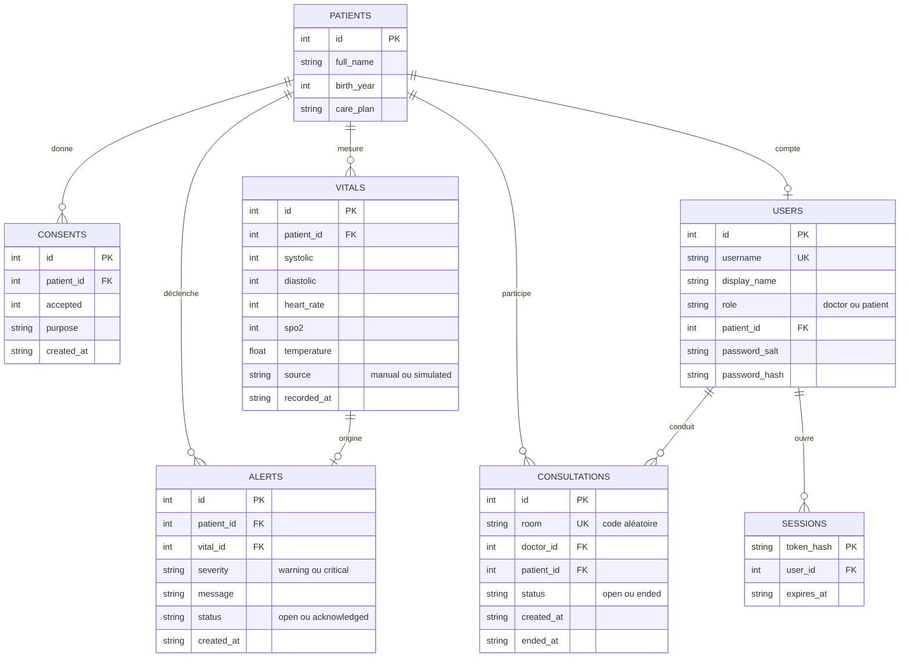

# Architecture technique

## Périmètre

SahaLink est un prototype de téléconsultation et de suivi à distance. Il met en relation des patients fictifs (le compte de démonstration Amal El Idrissi, suivie pour hypertension, et tout patient qui crée son compte) et un médecin fictif (Dr. Benali) : le patient donne son consentement et saisit ses constantes, le médecin choisit un patient dans sa liste, voit l'évolution des constantes sur quatre graphiques, reçoit les alertes en temps réel, ouvre une téléconsultation vidéo et le patient la rejoint sur invitation. Aucune donnée réelle n'est utilisée.

## Schéma d'architecture

### Légende

| Symbole | Signification |
|---|---|
| Flèche pleine | Échange applicatif via le serveur (REST ou WebSocket), toujours authentifié par jeton de session |
| Double flèche épaisse | Média vidéo et audio WebRTC, pair à pair, chiffré DTLS/SRTP, sans passer par le serveur |
| Flèche pointillée | Découverte du chemin réseau (STUN) ou relais (TURN, optionnel) |
| Cadre « Navigateurs » | Les deux acteurs humains : patient et médecin |
| Cadre « Serveur FastAPI » | Le seul composant serveur ; il ne voit jamais le flux vidéo |

## Composants et interfaces

| Composant | Rôle | Interface |
|---|---|---|
| Interface patient | Inscription, consentement, saisie des constantes, historique, invitation, salle vidéo | HTML, CSS, JavaScript |
| Interface médecin | Liste des patients, tableau de bord, quatre graphiques avec seuils, alertes, historique, démarrage de la consultation, salle vidéo | HTML, CSS, JavaScript |
| Authentification | Connexion avec verrouillage après échecs, inscription patient, sessions de 8 h, déconnexion, contrôle des rôles | `POST /api/auth/login`, `/api/auth/register`, `/api/auth/logout`, `/api/auth/me` |
| API REST | Validation, règles de seuil, persistance | `GET /api/patients`, `/api/patients/{id}/vitals`, `/consents`, `/api/dashboard?patient_id=`, `/api/alerts`, `/api/consultations` |
| Canal événements | Alertes, nouvelles mesures, consentements et inscriptions vers le médecin ; invitations et fin de consultation vers le patient | WebSocket `/ws/events` |
| Canal de signalisation | Relais SDP/ICE entre les deux participants d'une consultation | WebSocket `/ws/signaling/{room}` |
| Configuration ICE | Serveurs STUN, TURN configurable par variable d'environnement | `GET /api/rtc-config` |
| Base de données | Patients, comptes, sessions, consentements, constantes, alertes, consultations | SQLite (choix justifié ci-dessous) |

## Modèle de données

Le dernier consentement d'un patient fait foi : la téléconsultation ne peut démarrer que si ce dernier enregistrement est une acceptation.

## Droits par rôle

| Action | Médecin | Patient |
|---|---|---|
| Se connecter, consulter sa session | oui | oui |
| Créer un compte | non | oui (inscription ; le rôle patient est imposé par le serveur) |
| Lister les patients | oui | non (403) |
| Lire les constantes d'un dossier | oui | uniquement le sien |
| Envoyer une constante | oui | uniquement pour lui |
| Donner ou retirér le consentement | non (403) | uniquement pour lui |
| Lire les alertes et le tableau de bord | oui | non (403) |
| Acquitter une alerte | oui | non (403) |
| Démarrer une téléconsultation | oui, si consentement (sinon 409) | non (403) |
| Rejoindre la salle vidéo | si c'est sa consultation | si c'est sa consultation |
| Terminer la consultation | oui | non (le patient peut quitter et revenir) |

Ces règles sont appliquées par le serveur sur chaque route ; l'interface ne fait que masquer les menus inutiles. Elles sont vérifiées par `tests/test_api.py`.

## Flux clinique

1. Le patient crée son compte (ou utilise le compte de démonstration) et le médecin se connecte ; le médecin choisit un patient dans sa liste.
2. Le patient lit le texte de consentement et confirme son accord, ou le refuse.
3. Le patient saisit ses constantes. L'API les valide, les enregistre avec une date et une source, puis compare les valeurs aux seuils définis dans `app/main.py`.
4. En cas de dépassement, une alerte horodatée est créée et envoyée en temps réel au seul médecin par `/ws/events`.
5. Le médecin consulte l'historique et acquitte l'alerte.
6. Le médecin démarre la téléconsultation : le serveur vérifie le consentement, crée une consultation avec un code de salle aléatoire et envoie une invitation au patient.
7. Le patient accepte l'invitation. Les deux navigateurs s'authentifient sur le canal de signalisation, échangent offre, réponse et candidats ICE, puis le flux vidéo s'établit directement entre eux.
8. Le médecin termine la consultation : le patient est prévenu et les deux caméras s'arrêtent.

## Choix de conception et justification

- **WebRTC en pair à pair** : le flux vidéo ne passe pas par le serveur, qui ne stocke aucune vidéo. C'est la norme imposée par le sujet et elle réduit la charge et l'exposition des données.
- **REST pour les données, WebSocket pour le temps réel** : une alerte ou une invitation doit arriver sans interrogation périodique ; le même canal sert aux deux événements.
- **Authentification dans le premier message WebSocket** : le jeton n'apparaît jamais dans l'URL, donc pas dans les journaux ni l'historique. L'origine de la page est vérifiée contre le détournement de WebSocket.
- **Code de salle aléatoire lié à un médecin et un patient** : une salle ne peut pas être devinée ni rejointe par un tiers, deux participants au maximum.
- **Pairs « polis » pour la négociation WebRTC** : si les deux navigateurs envoient une offre en même temps, l'un cède, ce qui évite les appels bloqués.
- **Choix de la caméra** : les caméras virtuelles de téléphone (Camo, Iriun) sont classées en dernier et chaque caméra est testée sur une image réelle avant usage.
- **SQLite, choix assumé** : aucune installation, donc démonstration reproductible, et suffisant pour un serveur unique à faible charge. L'accès passe par une seule fonction de connexion, ce qui faciliterait un passage à PostgreSQL pour un déploiement multi-établissements ; ce passage n'est pas réalisé.
- **Politique de sécurité du contenu (CSP) et échappement** : les noms saisis par les patients s'affichent chez le médecin ; ils sont validés côté serveur, échappés avant tout affichage, et la CSP interdit tout script ou connexion venant d'ailleurs.
- **Graphiques en SVG intégré** : quatre petits graphiques (tension, fréquence cardiaque, SpO2, température) avec lignes de seuil, sans dépendance externe, ce qui garde la CSP stricte.
- **Seuils explicites et simples** : tension systolique >= 180 ou diastolique >= 120 (critique), SpO2 < 90 % (critique), fréquence cardiaque < 45 ou > 130 bpm, température >= 39,0 degrés. Ils servent à la démonstration et ne constituent pas une aide médicale réelle.
- **Validation des entrées** : les validateurs Pydantic rejettent les valeurs physiologiquement impossibles avant écriture en base.
