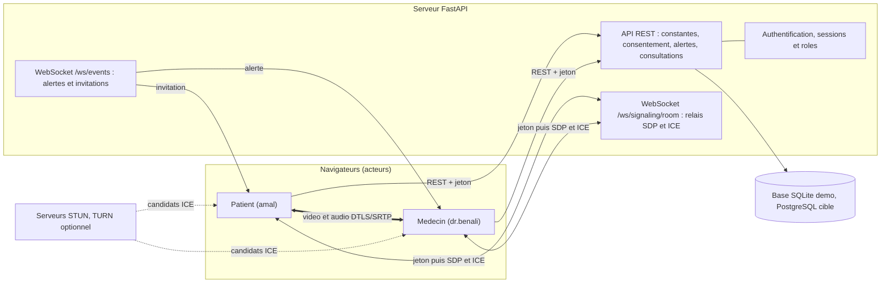

# Architecture technique

## Perimetre

SahaLink est un prototype de teleconsultation et de suivi a distance. Il met en relation un patient fictif (Amal El Idrissi, suivie pour hypertension) et un medecin fictif (Dr. Benali) : le patient donne son consentement et saisit ses constantes, le medecin recoit les alertes en temps reel, ouvre une teleconsultation video et le patient la rejoint sur invitation. Les deux comptes sont des comptes de demonstration ; aucune donnee reelle n'est utilisee.

## Schema d'architecture

### Legende

| Symbole | Signification |
|---|---|
| Fleche pleine | Echange applicatif via le serveur (REST ou WebSocket), toujours authentifie par jeton de session |
| Double fleche epaisse | Media video et audio WebRTC, pair a pair, chiffre DTLS/SRTP, sans passer par le serveur |
| Fleche pointillee | Decouverte du chemin reseau (STUN) ou relais (TURN, optionnel) |
| Cadre « Navigateurs » | Les deux acteurs humains : patient et medecin |
| Cadre « Serveur FastAPI » | Le seul composant serveur ; il ne voit jamais le flux video |

## Composants et interfaces

| Composant | Role | Interface |
|---|---|---|
| Interface patient | Consentement, saisie des constantes, historique, invitation, salle video | HTML, CSS, JavaScript |
| Interface medecin | Tableau de bord, alertes, historique, demarrage de la consultation, salle video | HTML, CSS, JavaScript |
| Authentification | Connexion, sessions de 8 h, deconnexion, controle des roles | `POST /api/auth/login`, `/api/auth/logout`, `/api/auth/me` |
| API REST | Validation, regles de seuil, persistance | `/api/patients/{id}/vitals`, `/consents`, `/api/alerts`, `/api/consultations` |
| Canal evenements | Alertes vers le medecin, invitations et fin de consultation vers le patient | WebSocket `/ws/events` |
| Canal de signalisation | Relais SDP/ICE entre les deux participants d'une consultation | WebSocket `/ws/signaling/{room}` |
| Configuration ICE | Serveurs STUN, TURN configurable par variable d'environnement | `GET /api/rtc-config` |
| Base de demonstration | Patients, comptes, sessions, consentements, constantes, alertes, consultations | SQLite, migrable vers PostgreSQL |

## Modele de donnees

Le dernier consentement d'un patient fait foi : la teleconsultation ne peut demarrer que si ce dernier enregistrement est une acceptation.

## Droits par role

| Action | Medecin | Patient |
|---|---|---|
| Se connecter, consulter sa session | oui | oui |
| Lire les constantes d'un dossier | oui | uniquement le sien |
| Envoyer une constante | oui | uniquement pour lui |
| Donner ou retirer le consentement | non (403) | uniquement pour lui |
| Lire les alertes et le tableau de bord | oui | non (403) |
| Acquitter une alerte | oui | non (403) |
| Demarrer une teleconsultation | oui, si consentement (sinon 409) | non (403) |
| Rejoindre la salle video | si c'est sa consultation | si c'est sa consultation |
| Terminer la consultation | oui | non (le patient peut quitter et revenir) |

Ces regles sont appliquees par le serveur sur chaque route ; l'interface ne fait que masquer les menus inutiles. Elles sont verifiees par `tests/test_api.py`.

## Flux clinique

1. Le patient et le medecin se connectent chacun avec leur compte.
2. Le patient lit le texte de consentement et confirme son accord, ou le refuse.
3. Le patient saisit ses constantes. L'API les valide, les enregistre avec une date et une source, puis compare les valeurs aux seuils definis dans `app/main.py`.
4. En cas de depassement, une alerte horodatee est creee et envoyee en temps reel au seul medecin par `/ws/events`.
5. Le medecin consulte l'historique et acquitte l'alerte.
6. Le medecin demarre la teleconsultation : le serveur verifie le consentement, cree une consultation avec un code de salle aleatoire et envoie une invitation au patient.
7. Le patient accepte l'invitation. Les deux navigateurs s'authentifient sur le canal de signalisation, echangent offre, reponse et candidats ICE, puis le flux video s'etablit directement entre eux.
8. Le medecin termine la consultation : le patient est prevenu et les deux cameras s'arretent.

## Choix de conception et justification

- **WebRTC en pair a pair** : le flux video ne passe pas par le serveur, qui ne stocke aucune video. C'est la norme imposee par le sujet et elle reduit la charge et l'exposition des donnees.
- **REST pour les donnees, WebSocket pour le temps reel** : une alerte ou une invitation doit arriver sans interrogation periodique ; le meme canal sert aux deux evenements.
- **Authentification dans le premier message WebSocket** : le jeton n'apparait jamais dans l'URL, donc pas dans les journaux ni l'historique. L'origine de la page est verifiee contre le detournement de WebSocket.
- **Code de salle aleatoire lie a un medecin et un patient** : une salle ne peut pas etre devinee ni rejointe par un tiers, deux participants au maximum.
- **Pairs « polis » pour la negociation WebRTC** : si les deux navigateurs envoient une offre en meme temps, l'un cede, ce qui evite les appels bloques.
- **Choix de la camera** : les cameras virtuelles de telephone (Camo, Iriun) sont classees en dernier et chaque camera est testee sur une image reelle avant usage.
- **SQLite pour la demonstration** : aucune installation, donc demonstration reproductible. L'acces passe par une seule fonction de connexion, ce qui facilite le passage a PostgreSQL pour un deploiement multi-utilisateurs.
- **Seuils explicites et simples** : tension systolique >= 180 ou diastolique >= 120 (critique), SpO2 < 90 % (critique), frequence cardiaque < 45 ou > 130 bpm, temperature >= 39,0 degres. Ils servent a la demonstration et ne constituent pas une aide medicale reelle.
- **Validation des entrees** : les validateurs Pydantic rejettent les valeurs physiologiquement impossibles avant ecriture en base.
