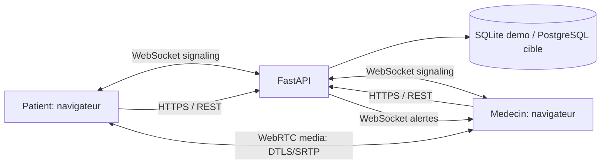

# Architecture technique

## Perimetre

SahaLink est un prototype local de teleconsultation cible sur un seul patient fictif. Il permet au patient de saisir des constantes et au medecin de les suivre, de recevoir une alerte et de rejoindre une consultation video.

## Composants

| Composant | Role | Interface |
|---|---|---|
| Interface patient | Consentement, saisie des constantes, historique, salle video | HTML, CSS, JavaScript |
| Interface medecin | Tableau de bord, alertes, historique patient, salle video | HTML, CSS, JavaScript |
| API FastAPI | Validation, regles de seuil, persistance et exposition REST | Python / FastAPI |
| Canal alertes | Notification de nouvelle alerte au tableau de bord | WebSocket `/ws/alerts` |
| Canal WebRTC | Relai SDP/ICE entre deux navigateurs d'une meme salle | WebSocket `/ws/signaling/{room}` |
| Base de demonstration | Patients, consentements, constantes et alertes | SQLite, migrable vers PostgreSQL |

## Flux clinique

1. Le patient consulte le texte de consentement et confirme son accord.
2. Le patient saisit ses constantes. L'API les valide puis les enregistre avec une date et une source.
3. Le moteur compare les valeurs aux seuils definis dans `app/main.py`.
4. En cas de depassement, une alerte horodatee est creee puis diffusee en temps reel au medecin.
5. Le medecin consulte l'historique, acquitte l'alerte et lance si besoin une teleconsultation WebRTC.

## Choix de conception

- Le media video passe directement entre navigateurs. Le serveur ne stocke pas de flux video.
- Le prototype utilise SQLite sans service externe afin d'etre reproductible. La separation API/base facilite le remplacement par PostgreSQL en deploiement.
- Les validateurs Pydantic bloquent les valeurs physiologiquement incoherentes avant ecriture en base.
- Les seuils restent explicites et simples pour une demonstration. Ils ne constituent pas une aide medicale reelle.

