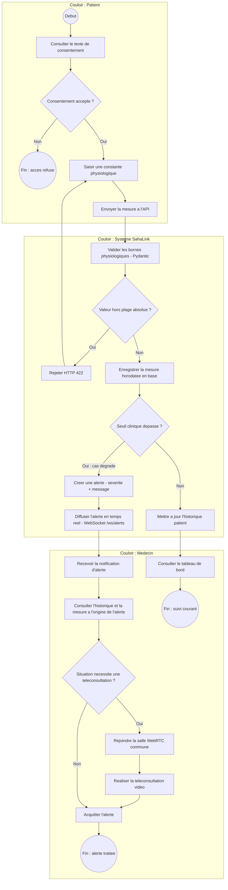

# Parcours patient (BPMN)

## Objectif

Formaliser le processus metier de bout en bout, avec un couloir par acteur (notation BPMN : evenement de depart en cercle fin, tache en rectangle, decision en losange, evenement de fin en cercle epais), incluant le cas degrade (constante hors seuil).

## Diagramme

## Legende des elements

| Symbole | Signification BPMN | Occurrence dans le processus |
|---|---|---|
| Cercle fin | Evenement de debut | Arrivee du patient sur l'application |
| Rectangle | Tache utilisateur ou systeme | Saisie, validation, enregistrement, diffusion, consultation |
| Losange | Passerelle de decision exclusive (XOR) | Consentement accepte ou non ; valeur hors plage ou non ; seuil clinique depasse ou non ; teleconsultation necessaire ou non |
| Cercle epais | Evenement de fin | Acces refuse, suivi courant cloture, alerte traitee |

## Lien avec le cas degrade exige par le cadrage

Le cas degrade (donnee anormale) correspond a la branche `J -- Oui`. Il est reproductible via le bouton **Simuler une alerte** de l'interface patient et verifie automatiquement par `tests/test_api.py::test_critical_vital_creates_an_alert`. Un second cas degrade, le rejet d'une valeur hors plage absolue (`G -- Oui`), est verifie par `test_invalid_vital_is_rejected`.
