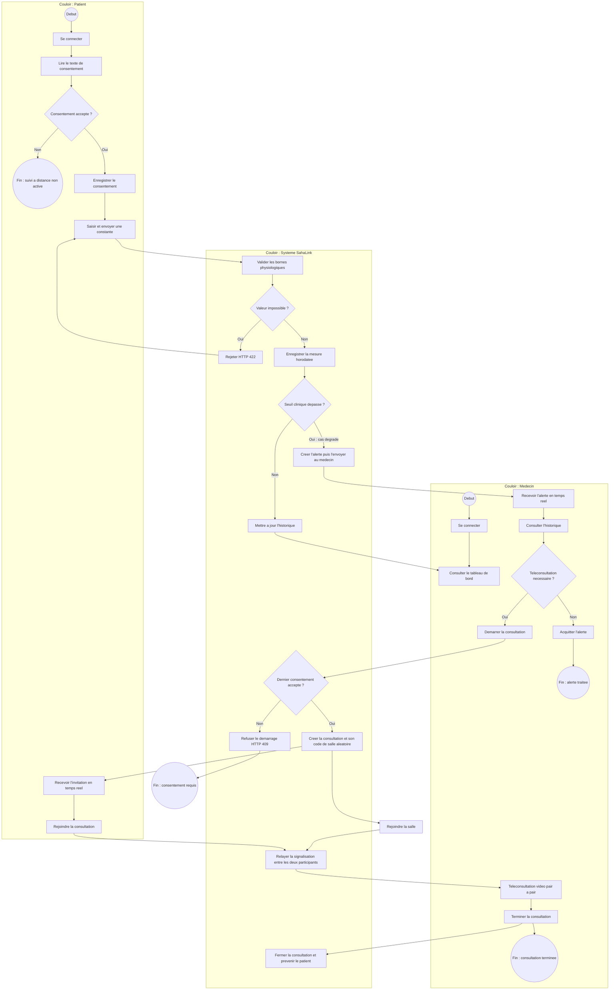

# Parcours patient-medecin (BPMN)

## Objectif

Formaliser le processus metier de bout en bout, avec un couloir par acteur (notation BPMN : evenement de depart en cercle fin, tache en rectangle, decision en losange, evenement de fin en cercle epais). Le diagramme couvre le parcours nominal et les cas degrades.

## Diagramme

## Legende des elements

| Symbole | Signification BPMN | Occurrence dans le processus |
|---|---|---|
| Cercle fin | Evenement de debut | Connexion du patient ou du medecin |
| Rectangle | Tache utilisateur ou systeme | Saisie, validation, enregistrement, envoi d'alerte, consultation |
| Losange | Passerelle de decision exclusive (XOR) | Consentement accepte ou non ; valeur impossible ou non ; seuil depasse ou non ; teleconsultation necessaire ou non ; consentement valide ou non |
| Cercle epais | Evenement de fin | Suivi non active, alerte traitee, consultation terminee, consentement requis |
| Couloir | Acteur responsable de la tache | Patient, systeme SahaLink, medecin |

## Cas degrades couverts

| Cas degrade | Branche du diagramme | Comportement | Verification |
|---|---|---|---|
| Valeur physiologiquement impossible | `SB - Oui` | Mesure rejetee (HTTP 422), rien n'est enregistre | `test_invalid_vital_is_rejected` |
| Constante hors seuil | `SE - Oui` | Alerte creee et envoyee au medecin en temps reel | `test_critical_vital_alerts_the_doctor`, bouton « Simuler une alerte » |
| Consentement absent ou retire | `SH - Non` | Demarrage de la consultation refuse (HTTP 409) | `test_consultation_requires_consent` |
| Troisieme personne dans la salle | `SK` | Connexion refusee, message « room-full » | `test_signaling_room_rejects_a_third_peer` |
| Tiers sans jeton ou hors consultation | `SK` | Connexion refusee, `auth-failed` ou `forbidden` | `test_signaling_rejects_a_missing_token`, `test_signaling_rejects_an_unknown_room` |
| Perte ou depart du correspondant | `SK`, `DL` | L'autre participant est prevenu et peut attendre le retour | `test_signaling_notifies_remaining_peer_when_one_leaves` |
| Camera noire ou virtuelle | `DK`, `PJ` | Le statut explique le probleme et propose de changer de camera | Test manuel (voir README) |
