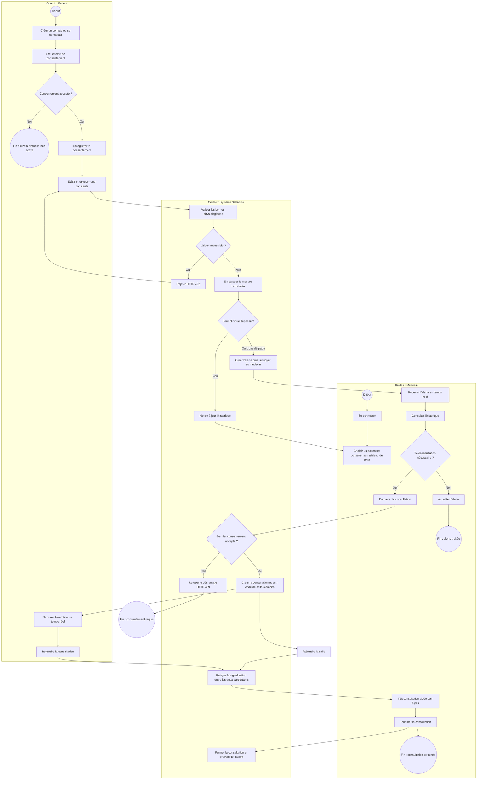

# Parcours patient-médecin (BPMN)

## Objectif

Formaliser le processus métier de bout en bout, avec un couloir par acteur (notation BPMN : événement de départ en cercle fin, tâche en rectangle, décision en losange, événement de fin en cercle épais). Le diagramme couvre le parcours nominal et les cas dégradés.

## Diagramme

## Légende des éléments

| Symbole | Signification BPMN | Occurrence dans le processus |
|---|---|---|
| Cercle fin | Événement de début | Connexion du patient ou du médecin |
| Rectangle | Tâche utilisateur ou système | Saisie, validation, enregistrement, envoi d'alerte, consultation |
| Losange | Passerelle de décision exclusive (XOR) | Consentement accepté ou non ; valeur impossible ou non ; seuil dépassé ou non ; téléconsultation nécessaire ou non ; consentement valide ou non |
| Cercle épais | Événement de fin | Suivi non activé, alerte traitée, consultation terminée, consentement requis |
| Couloir | Acteur responsable de la tâche | Patient, système SahaLink, médecin |

## Cas dégradés couverts

| Cas dégradé | Branche du diagramme | Comportement | Vérification |
|---|---|---|---|
| Valeur physiologiquement impossible | `SB - Oui` | Mesure rejetée (HTTP 422), rien n'est enregistré | `test_invalid_vital_is_rejected` |
| Constante hors seuil | `SE - Oui` | Alerte créée et envoyée au médecin en temps réel | `test_critical_vital_alerts_the_doctor`, bouton « Simuler une alerte » |
| Consentement absent ou retiré | `SH - Non` | Démarrage de la consultation refusé (HTTP 409) | `test_consultation_requires_consent` |
| Troisième personne dans la salle | `SK` | Connexion refusée, message « room-full » | `test_signaling_room_rejects_a_third_peer` |
| Tiers sans jeton ou hors consultation | `SK` | Connexion refusée, `auth-failed` ou `forbidden` | `test_signaling_rejects_a_missing_token`, `test_signaling_rejects_an_unknown_room` |
| Perte ou départ du correspondant | `SK`, `DL` | L'autre participant est prévenu et peut attendre le retour | `test_signaling_notifies_remaining_peer_when_one_leaves` |
| Caméra noire ou virtuelle | `DK`, `PJ` | Le statut explique le problème et propose de changer de caméra | Test manuel (voir README) |
